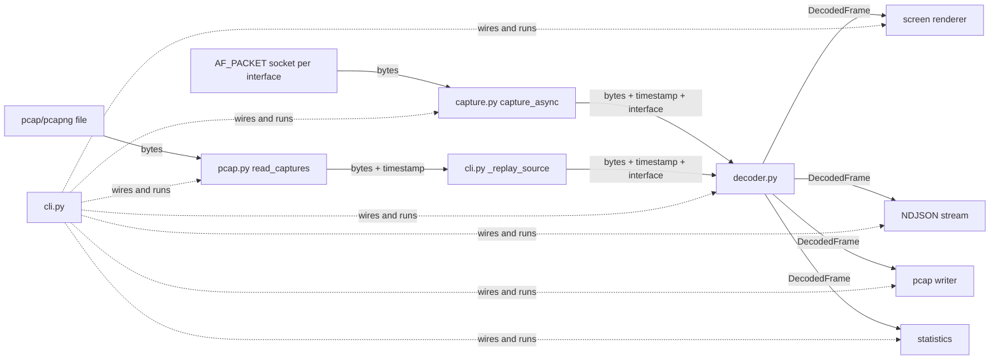

# How RootWire works

A guided tour of the application for contributors and the curious. The
protocol parsing itself lives in the
[NETProtocols](https://github.com/EONRaider/NETProtocols) library
(which has [its own tour](https://github.com/EONRaider/NETProtocols/blob/master/ARCHITECTURE.md));
this document covers everything around it: capturing, replaying,
orchestrating, rendering, and staying alive for hours.

## The pipeline

One frame flows from a source, through the decoder, to every output:



- **[`capture.py`](src/rootwire/capture.py)** opens one raw
  `AF_PACKET` socket per requested interface (every EtherType; a
  single unbound socket for "all interfaces"), optionally attaches a
  kernel-side capture filter to each, and merges them into one
  `async` stream of `(bytes, timestamp, interface)` triples —
  `capture_async()` registers every socket with the running event
  loop (`add_reader`) and yields whichever socket has data next, so
  capturing on several interfaces concurrently is the same code path
  as capturing on one, not a separate mode.
- **[`bpf.py`](src/rootwire/bpf.py)** holds the canned classic-BPF
  (cBPF) programs `--filter` selects from and the `SO_ATTACH_FILTER`
  plumbing `capture.py` calls into. Each canned program's bytecode is
  a golden fixture, checked byte-for-byte against `tcpdump -dd`.
- **[`bpf_compiler.py`](src/rootwire/bpf_compiler.py)** compiles a
  small, explicitly-bounded subset of tcpdump-style filter expressions
  (`tcp and port 80`) to the same cBPF shape `bpf.py`'s canned programs
  use — `--filter` tries a canned name first, falling back to this
  compiler for anything else. Validated by *behavior*, not by matching
  tcpdump's own instruction sequence (its decades-old peephole
  optimizer makes that impractical past a single bare primitive):
  `tests/bpf_vm.py` is a small cBPF interpreter that runs both this
  compiler's output and real `tcpdump -dd` bytecode against the
  project's captured-frame corpus and asserts they always agree.
- **[`pcap.py`](src/rootwire/pcap.py)** writes classic pcap by hand and
  reads classic pcap *or* pcapng via NETProtocols'
  `read_captures()` (auto-detected from magic bytes). RootWire's own
  `read_captures()` yields `(bytes, timestamp)` pairs; `cli.py`'s
  `_replay_source()` adapts that into the same
  `(bytes, timestamp, interface)` shape `capture_async()` produces —
  tagging every replayed frame with the file's path, since a replayed
  capture carries no interface metadata RootWire can recover — so
  `-r FILE` is a drop-in frame source and the whole pipeline runs
  against a file, no privileges needed. Before decoding, the capture's
  declared link type is checked against Ethernet where it can be
  determined up front (always for classic pcap; every Interface
  Description Block for pcapng, since an Enhanced Packet Block can
  reference any of them), since nothing else stops a wrong link type
  from silently decoding into nonsense.
- **[`decoder.py`](src/rootwire/decoder.py)** turns one frame's bytes
  into a `DecodedFrame` — a pure function with no state between calls.
  How it walks is a `DecodeOptions` value built once per capture by
  `decode_options()`: the dispatch registry the walk resolves against
  (the library's default, or a child derived with `--decode-as`'s
  overrides via `Registry.derive`, so no per-frame copy) and the set of
  classes the best-effort rule covers (below).
- **[`decode_as.py`](src/rootwire/decode_as.py)** parses
  `--decode-as TABLE=KEY:CLASS` into NETProtocols' `decode_as` form —
  table, wire value, then a decoder class or `WITHHELD` for `none`. It
  checks what the library leaves to the caller (a port or IP-protocol
  key in range, a table and key given once) and reports every refusal,
  the registry's own included, as an argument error.
- **[`frame.py`](src/rootwire/frame.py)** defines `DecodedFrame`:
  frozen, slotted, self-contained — including `raw`, the exact
  captured bytes (the same object the decoder received, so keeping it
  costs no copy; it is what the pcap writer emits).
- **[`output.py`](src/rootwire/output.py)** holds every consumer
  behind one small `Output` interface: the screen renderer, the NDJSON
  stream, the pcap writer, and the statistics collector.
- **[`cli.py`](src/rootwire/cli.py)** parses arguments, picks the
  source, assembles the outputs, and drives the async loop
  (`asyncio.run()`) — including converting `SIGTERM` into the same
  orderly cancellation Ctrl-C already gets for free from Python 3.11's
  `asyncio.Runner`.

## Why root, and why Linux-only

Ordinary sockets hand applications payloads; this tool wants whole
Ethernet frames, headers included, before the kernel's protocol stack
processes them. That is exactly what Linux's `AF_PACKET` socket family
provides — and it is Linux-only and privileged. Root works, and so
does the finer-grained alternative:

```
sudo setcap cap_net_raw+ep .venv/bin/python   # then run unprivileged
```

`PF_PACKET` is imported in exactly one module, `capture.py`, and
`cli.py` imports that module lazily — replaying a file with `-r` never
touches it. Everything else works with plain bytes, which is why the
entire test suite runs without root, without Linux, and without a
network.

## The frame lifecycle, and why memory stays flat

A capture session may run for hours at thousands of frames per second,
so the memory story is engineered, not accidental:

1. `capture_async()` yields **one freshly allocated, immutable `bytes`
   object per frame** — never a reused buffer. Nothing that happens
   later can be corrupted by the next `recvmsg`.
2. `decode_frame()` hands the `bytes` object straight to
   `netprotocols.decode_frame()`, which walks the layers — NETProtocols
   measured plain-`bytes` slicing as faster than a RootWire-side
   `memoryview` wrap for a single small frame, so this function no
   longer does its own wrapping. Every value the walk *keeps* (fields,
   options, payload) is materialized, and `frame.raw` simply holds the
   original object.
3. The resulting `DecodedFrame` is **immutable and self-contained**:
   no references to sockets or capture buffers. An earlier design
   reused one mutable decoder object per capture; any consumer that
   kept a frame saw it silently change under them. Never again.
4. The loop in `cli.run()` holds only the current frame. The moment it
   moves on, the previous frame's reference count hits zero and CPython
   frees it — no accumulation, no garbage-collection pressure, flat
   RSS regardless of capture duration.

The capture buffer is 65,550 bytes: a maximum-size IP datagram behind
an Ethernet header. The loopback interface routinely carries frames
far larger than any physical MTU, so a smaller buffer (an old
implementation used 9,000) silently truncates local traffic.

## Surviving the real network

Real interfaces deliver runt frames, exotic EtherTypes, datagrams cut
short by the capture itself — and, if someone is being creative,
deliberately hostile input. The decoder treats all of it as data, not
as exceptions to die on:

- **Unknown protocol?** The library's `next_protocol()` returns
  `None`, the chain ends, and the remaining bytes become the frame's
  payload. A frame with an unregistered EtherType renders as Ethernet
  plus payload instead of an error. A VLAN tag, by contrast, is not an
  unknown protocol at all: it is its own decoded layer
  (`Ethernet / VLAN / ...`), and the chain walks straight through it
  into whatever it encapsulates, including nested (QinQ) tags.
- **A port that only suggests a protocol?** NETProtocols dispatches
  TLS (443), BGP (179), STUN (3478), NTP (123), RADIUS (1812/1813),
  HSRP (1985), TFTP (69), RIP (520) and VXLAN (4789) on the port
  number alone, and calls that decoder whatever the segment holds. A
  bare ACK, a segment continuing a record begun in an earlier one, or
  another service on the port then fails to decode — which says
  nothing about the frame's health. `decoder.py` derives that set of
  port-dispatched classes from the registry the capture walks with —
  the default one, or the one `--decode-as` derived, so `HTTP` mapped
  to port 80 meets every bare ACK and every response-body segment as
  TLS on 443 does (minus DNS, DNS-over-TCP and DHCP, whose malformations
  predate the upgrade and stay real signal, and minus any class a type
  field also reaches — EtherType, LLC, IP protocol — since the rule
  matches on the class and `udp.port=4000:IPv4` must not turn every
  malformed IPv4 header into a miss) and records a stop inside
  one as `frame.l7_miss`, not `frame.error`: no `[!]`, not counted as
  malformed, the undecoded bytes left as payload, and a `[~]` note on
  screen only when there are bytes to explain. (`[~]` marks a line the
  analyst should read as information, not a fault; the TLS renderer
  uses it too, for a Handshake record that does not parse as the
  ClientHello its first byte announces, which an encrypted TLS 1.2
  Finished does one time in 256.) Checking the stopping
  *class*, not where in the frame the stop happened, is what keeps a
  truncated DNS header on port 53 an error. One miss is common enough
  to read anyway: a ClientHello larger than one segment (Chromium's,
  with its post-quantum key share). Its host name usually sits in the
  first segment, so for a TLS miss `decoder.py` runs NETProtocols'
  `peek_server_name()` over the undecoded bytes — a bounded, stateless
  read of the first record — and keeps a *found* name as
  `frame.sni_peek` (NDJSON `sni_peek`).
- **Malformed header?** The library raises a typed `ProtocolError`
  (truncated buffer, lying length field). `decode_frame()` calls the
  library's own `decode_frame()` with `lax=True`, which keeps the
  layers that did decode instead of propagating the exception;
  RootWire's `decode_frame()` records the diagnostic on `frame.error`.
  The capture continues. A declared length shorter than its own header
  (an IPv4 Total Length below `ihl * 4`, a UDP Length of 1 to 7) stops
  the walk at that header, since it bounds every layer after it; the
  IPv4 case is also flagged as `frame.malformed_length` and rendered
  once.
- **Padding and FCS?** The walk ends every buffer at the tightest end
  the frame's length fields declare; the bytes past it are the
  library's `packet.trailer`, kept as `frame.trailer` and out of
  `frame.payload`. Checksums do not use the trailer: each layer's
  checksum input ends at *its own* declared end (`_declared_end` in
  `output.py`: the tightest IPv4/IPv6/UDP/802.3 length among the
  headers enclosing it, itself included). The two differ in a tunnel,
  where the tightest end is the inner datagram's: an inner Ethernet
  frame's padding inside VXLAN is trailer, yet part of the outer UDP
  datagram its checksum covers.
- **Truncated datagram?** If the outermost IP header declares more
  bytes than were captured, `frame.truncated` is set and the renderer
  says so. The header's offset is the sum of the headers before it,
  so a VLAN tag, QinQ pair, MPLS stack or LLC/SNAP in front of it
  counts. Fragment checks follow the same per-layer rule: a checksum
  is skipped only when an IPv4 fragment or IPv6 Fragment header
  *encloses* its layer.
- **Crafted amplification?** The decode chain is capped at 32 layers
  per frame, the library's own default. IPv6 extension headers chain
  legitimately (an MLD report is `Ethernet / IPv6 / Hop-by-Hop /
  ICMPv6`), but a 65,535-byte frame of back-to-back 8-byte extension
  headers would otherwise decode ~8,100 layer objects. Past the cap,
  the frame is diagnosed and the capture moves on. BGP, STUN over TCP
  and TLS decode one layer per message or record, and a valid segment
  can hold more than the cap leaves room for (76 BGP KEEPALIVEs fit in
  1448 bytes): an overflow where the next layer would be another of
  the same port-dispatched class as the last is a miss, not an error,
  the remaining messages left as payload. Any other overflow — an
  extension-header chain that happens to reach port 443, a VXLAN
  nesting bomb — stays an error. No renderer starts a second walk to
  get round the cap: a PIM Register encapsulates a whole datagram, and
  NETProtocols' `PIMRegister.encapsulated` would run `decode_frame`
  over it, so the PIM renderer decodes only its inner IP header, by
  itself, for the flow being registered.

## Outputs

Every consumer implements one interface — `update(frame)` per frame,
plus an optional `close()` for resources at end of capture:

- **`OutputToScreen`** renders indented text. `_render` is a
  `singledispatchmethod`: registering a renderer for a layer type is
  one decorated method, and layers without one fall back to a generic
  line instead of crashing. Renderers receive the **whole frame**, not
  just their layer — the ICMP renderer prints the enclosing IP
  addresses, context a layer-only API could not provide. "Enclosing"
  means the *nearest* IP header before the layer (`_enclosing_ip`),
  together with any IPv6 Routing header with segments left between
  them: an inner TCP segment in a VXLAN or AH tunnel is checksummed
  over the inner datagram's pseudo-header, and one behind a Routing
  header over the route's final destination, exactly as
  `Packet.with_checksums()` fills them. Sections a layer parses
  lazily (DNS records, options, IGMP group records, ...) render inside
  `self._guard("...")`, which turns a `ProtocolError` into a `[!] ...
  malformed` line instead of an exception; every string that came off
  the wire, library diagnostics included, passes through
  `_sanitize_for_terminal` first. (A previous implementation dispatched on method-name
  strings; one typo'd property name crashed the display on every IPv6
  frame. Type dispatch removed that class of bug.)
- **`OutputToNDJSON`** (`--json`) prints one JSON object per frame:
  layer fields straight from the dataclasses, `bytes` hex-encoded at
  any depth (LLDP and CDP keep theirs inside TLV tuples) by a
  `json.dumps` `default=` hook, one line each, flushed. Each layer's
  `"type"` is its class name; a wire field of its own named `type`
  (ICMP, IGMP, BGP, ...) is emitted as `"type_"`. stdout carries *nothing else* — the banner, the
  statistics, and the abort notice all live on stderr — so
  `rootwire --json -r file.pcap | jq .` consumes cleanly.
- **`OutputToPcap`** (`-w`) writes `frame.raw` byte-exactly with its
  capture timestamp; the files open in Wireshark and tcpdump.
- **`StatsCollector`** tallies frames, bytes, malformed and truncated
  counts, and per-protocol totals bucketed by the innermost decoded
  layer among TCP/UDP/SCTP/ICMPv4/ICMPv6/ARP (an extension-header or
  non-first-fragment ending counts as `other`), and a per-conversation
  tally: frames and bytes per TCP/UDP/SCTP flow, both directions under
  one `netprotocols.flow.flow_key`. The flow is the *innermost* IP
  datagram's, so a tunnel counts under the conversation inside it, and
  a transport that carries a whole Ethernet frame (VXLAN's UDP) is an
  underlay, never a conversation — unlike `Packet.flow_key`, which
  keys the first transport. At most 65,536 conversations are tracked
  (a spoofed flood mints one per frame); frames of later ones are
  counted as untracked. The report — with duration and frames/s and the
  ten largest conversations by bytes — lands on stderr at Ctrl-C or
  replay end-of-file.

They compose freely: `sudo rootwire -i eth0 -w evidence.pcap --json`
renders NDJSON to stdout while archiving every frame to disk.

## Testing without root

The suite runs recorded traffic, not sockets. Its backbone is a
**617-frame corpus of real captured frames** (42 captures — see
[tests/fixtures/MANIFEST.md](tests/fixtures/MANIFEST.md)) vendored from
the NETProtocols 2.9.0 repository, where every frame's checksums were
verified before being committed. Corpus tests drive each frame through
decode, render *and* NDJSON, and assert that no rendered checksum
reads as a mismatch, since upstream guarantees every one verifies; the pcap tests replay every corpus file through
`read_captures` and cross-validate it against an independent reader; the
rest covers payload offsets with TCP options, unknown EtherTypes,
truncation diagnostics, fragment labeling, NDJSON schema and stdout
purity, statistics bucketing, and buffer-aliasing regressions.

```
uv sync
uv run pytest
uv run mypy && uv run ruff check
```

CI runs those gates on Python 3.12–3.14; the library dependency
resolves from PyPI like any other.
